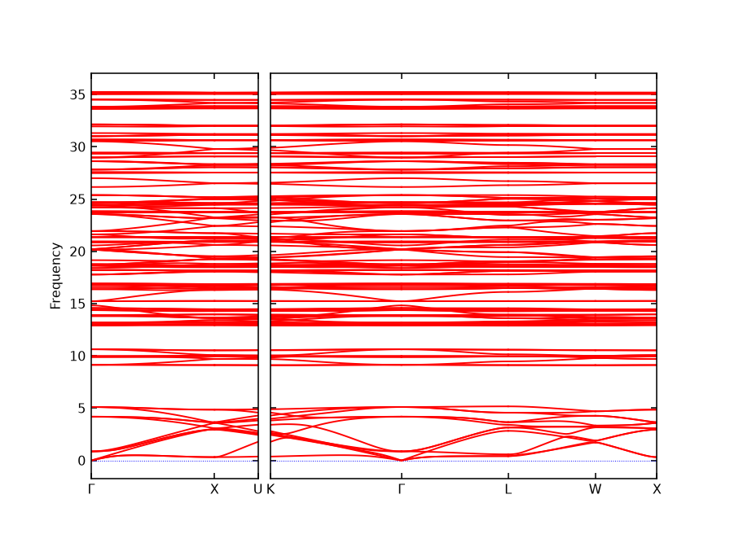

# C28 hyperdiamond: a dynamical-stability check

[](https://doi.org/10.5281/zenodo.24154048)

C28 hyperdiamond is a hypothetical carbon crystal proposed in 1992: diamond's lattice with a 28-atom fullerene cage on every site. It has been studied with density-functional theory (DFT) but never synthesised.

This repository asks one question: **is the structure dynamically stable, meaning free of vibrational modes that would tear it apart?** It answers with a DFT calculation at the zone centre and a machine-learned interatomic potential across the rest of the zone, and states plainly what that does and does not show.

## Why I did this

This project started with a physics talk at my school about carbon structures: C60, nanotubes and the wider fullerene family. C28 was the one that caught my interest. It is the smallest fullerene seen in quantity, and its four open bonds point in the same directions as the bonds of a single carbon atom in diamond.

The speaker also talked about potential for producing a hyperdiamond, a crystal built from cages in place of atoms. A material that light, fully bonded, and with a band gap closer to a semiconductor's than diamond's sounded like something that could matter a great deal if it could ever be made. I wanted to look into it properly, not just read about it.

When I did, I found that the idea is over thirty years old and that the main calculations date from the 1990s. I could not find a recent study asking a basic question: would the structure hold together, or would its own vibrations pull it apart? That question can be tested on a laptop, so I tested it.

I am an A-level student, not a researcher. This is a screening result with clear limits, which are set out above. My aim is to add one small, checkable piece of evidence and to make everything open, so that anyone with better tools can confirm it, correct it, or take it further.

## Result

**C28 hyperdiamond shows no dynamical instability, in a DFT calculation at the zone centre and in a machine-learned screening across the whole Brillouin zone.**

### DFT (Quantum ESPRESSO, PBE)

| | C28 hyperdiamond | Diamond (control) |
|---|---|---|
| Symmetry after relaxation | Fd-3m | Fd-3m |
| Cubic cell edge | 15.990 Å | 3.572 Å (measured 3.567) |
| Energy above diamond | 0.569 eV/atom | 0 |
| Density | 1.09 g/cm³ | 3.50 g/cm³ |
| Bond lengths | 1.412, 1.508, 1.542 Å in the cage; 1.546 Å between cages | 1.547 Å |
| Lowest optical modes at Γ | 1.77, 5.59, 6.65 THz (each triply degenerate) | n/a |
| Highest mode at Γ | 1504 cm⁻¹ | 1289 cm⁻¹ (measured 1332) |
| Imaginary modes at Γ | none | none |

The diamond control reproduces the standard PBE values, which is the check that the setup is sound. The published LDA cell edge for hyperdiamond is 15.777 Å (Zeger et al. 1995); LDA generally gives smaller cells than PBE.

### Machine-learned potential (MACE-MP-0), full Brillouin zone

| Run | Cubic cell edge (Å) | Energy above diamond (eV/atom) | Softest optical mode at Γ (THz) | Next mode (THz) | Imaginary modes |
|---|---|---|---|---|---|
| small, 2×2×2 supercell | 16.028 | 0.617 | 1.48 | 4.71 | none |
| medium, 2×2×2 supercell | 15.945 | 0.580 | 0.87 | 4.19 | none |
| large, 2×2×2 supercell | 15.991 | 0.651 | 1.32 | 4.97 | none |
| medium, 3×3×3 supercell | 15.945 | 0.580 | 0.87 | 4.19 | none |
| **DFT (PBE), Γ only** | **15.990** | **0.569** | **1.77** | **5.59** | **none** |

The potential agrees with DFT on the cell edge to within about 0.3% and on the energy to within about 0.08 eV/atom. It underestimates the soft mode's frequency, but every model and the DFT calculation agree that the mode is real and well separated from the rest.



### What the soft mode is

Projecting the mode onto rigid-body motion of each cage (MACE-MP-0 medium):

| Mode | Rigid rotation | Rigid translation | Cage deformation |
|---|---|---|---|
| Lowest optical (0.87 THz ML, 1.77 THz DFT) | 99.8% | 0.0% | 0.2% |
| Next (4.19 THz ML, 5.59 THz DFT) | 0.0% | 89.6%, cages moving against each other | 10.4% |

The softest vibration is the cages twisting as rigid bodies about their single connecting bonds. The next is the two cages moving against each other, the analogue of diamond's own optical mode. Hyperdiamond vibrates like a crystal of rigid superatoms, which is the picture Kaxiras et al. proposed in 1994 from its electronic structure.

### Elastic constants (MACE-MP-0 medium)

| | C11 (GPa) | C12 (GPa) | C44 (GPa) | Bulk modulus (GPa) | Mechanically stable |
|---|---|---|---|---|---|
| C28 hyperdiamond | 44 | 9 | 14 | 21 | yes (Born criteria) |
| Diamond, same method | 823 | 254 | 244 | 443 | yes |
| Diamond, measured | 1079 | 124 | 578 | 443 | |

The potential gets diamond's bulk modulus right but its shear constants badly wrong, so only hyperdiamond's bulk modulus should be taken as a rough estimate: about one twentieth of diamond's.

### Heated molecular dynamics (MACE-MP-0 medium, 56 atoms, 3 ps)

| Temperature | Bonds permanently broken | New bonds formed | Longest bond seen |
|---|---|---|---|
| 300 K | 0 | 0 | 1.72 Å |
| 1500 K | 0 | 0 | 1.99 Å |

At 1500 K, single bonds stretched past 1.9 Å in 7 of 60 snapshots and returned each time. The bond network was the same at the end as at the start.

### Related structures (MACE-MP-0 medium, screening only)

The same relaxation and phonon test on two relatives of hyperdiamond. Neither has been checked with DFT here.

| | C28 hyperdiamond | Hyperlonsdaleite | C28C |
|---|---|---|---|
| What it is | Cages on the diamond lattice | Cages on the hexagonal-diamond lattice | Cages alternating with single carbon atoms (zincblende) |
| Symmetry after relaxation | Fd-3m | P6₃/mmc | F-43m |
| Cell | a = 15.945 Å | a = 11.284 Å, c = 18.490 Å | a = 9.742 Å |
| Energy above diamond (eV/atom) | 0.580 | 0.584 | 0.428 |
| Density (g/cm³) | 1.10 | 1.10 | 2.50 |
| Softest optical mode at Γ (THz) | 0.87 | 0.22 | 8.89 |
| Imaginary modes | none | none | none |
| Phonon supercell | 2×2×2, 448 atoms | 2×2×1, 448 atoms | 3×3×3, 783 atoms |

- **Hyperlonsdaleite** is almost equal in energy to hyperdiamond, 4 meV per atom higher. Seifert et al. (2005) reported the two phases as nearly isoenergetic. Its softest mode is very low, 0.22 THz, and the potential underestimated the corresponding hyperdiamond mode by a factor of two against DFT, so this one in particular needs a DFT check before anything is claimed.
- **C28C** comes out lower in energy than hyperdiamond, as Zeger et al. (1995) found with LDA (0.453 against 0.744 eV/atom there). On relaxation it forms six extra bonds of 1.59 Å between neighbouring cages; the 1995 paper reported the same bonds at 1.64 Å. It has no soft cage-rotation mode, because those extra bonds lock the cages in place.

## What this is not

- **The DFT phonons cover the zone centre only.** They were computed in the 56-atom primitive cell, so they test the Γ point. Stability away from Γ rests on the machine-learned potential. A full DFT dispersion needs a 448-atom supercell, which is beyond the free computing used here.
- **The machine-learned models are imperfect on carbon.** For diamond they give:

  | Model | Cell edge (measured 3.567 Å) | Highest phonon (measured 1332 cm⁻¹) |
  |---|---|---|
  | small | 3.582 | 997 |
  | medium | 3.570 | 1172 |
  | large | 3.532 | 1331 |

  No single model gets both right, and they place hyperdiamond's highest mode near 1200 cm⁻¹ where DFT gives 1504 cm⁻¹.
- **Three sizes of one model family are not three independent methods.**
- **One functional, one set of settings.** PBE with a 45 Ry cutoff and a 2×2×2 k-point mesh. No convergence study, no van der Waals correction, no second functional.
- **Harmonic and short.** The phonons are harmonic at zero temperature. The molecular dynamics covers 3 ps in a 56-atom cell, which can show that a structure does not fall apart at once, not that it survives for long.
- **Stable does not mean makeable.** The structure is 0.57 eV per atom above diamond, and nobody knows how to assemble oriented C28 cages.
- **Prior work not fully reviewed.** I have not read Seifert, Enyashin and Heine (2005) in full. Its abstract lists structures, energies, electronic spectra and bulk moduli, not phonons, but I cannot rule out that stability was addressed there or elsewhere.

## Status and next step

Done: DFT relaxation and zone-centre phonons, machine-learned phonons across the zone, soft-mode analysis, elastic constants, molecular dynamics.

Also done at screening level: hyperlonsdaleite and C28C.

Next: a DFT check of hyperlonsdaleite's very soft mode, and a full read of the earlier literature.

## Method

1. **Starting structure.** `hyperdiamond.cif` was built with exact Td cage symmetry from the relaxed bond lengths in Zeger et al. (1995): 1.407, 1.479 and 1.510 Å inside the cage, 1.539 Å between cages, a = 15.777 Å. It was checked for 12 pentagons, 4 hexagons, 42 bonds per cage, and 4-coordinate apex atoms.
2. **Relaxation.** Cell and atoms relaxed together (ASE BFGS with a Frechet cell filter) to forces below 0.005 eV/Å.
3. **Phonons.** Finite displacements of 0.01 Å with phonopy: 10 symmetry-distinct displacements of a 448-atom (2×2×2) or 1512-atom (3×3×3) supercell of the 56-atom primitive cell.
4. **Control.** The same procedure on diamond, to measure each model's error on a known material.
5. **DFT.** Quantum ESPRESSO (conda-forge build), PBE, PAW pseudopotential `C.pbe-n-kjpaw_psl.1.0.0`, 45 / 360 Ry cutoffs, 2×2×2 k-points (8×8×8 for diamond). Variable-cell relaxation, then 10 symmetry-distinct displacements of 0.03 Å in the primitive cell. It runs on GitHub Actions; see `.github/workflows/dft.yml` and `dft/`.
6. **Soft mode, elastic constants, molecular dynamics.** `hyperdiamond-stability/extras.py`. Elastic constants from strains of ±0.5% with atoms relaxed at each strain. Molecular dynamics with a Langevin thermostat and a 1 fs step.

## Reproduce

Requires Python 3.12. Runs on a CPU; the 2×2×2 calculation takes about a minute.

```bash
pip install torch --index-url https://download.pytorch.org/whl/cpu
pip install -r requirements.txt
cd hyperdiamond-stability
python stability.py diamond
python stability.py hyper
python stability.py hyper --model large --tag hyper_large
python stability.py hyper --supercell 3 --tag hyper_medium_sc3
python stability.py custom --cif c28c.cif --supercell 3 --tag c28c
python stability.py custom --cif hyperlonsdaleite.cif --supercell 2,2,1 --tag hyperlonsdaleite
python extras.py softmode
python extras.py elastic
python extras.py md --temp 1500
```

## Files

| Path | Contents |
|---|---|
| `hyperdiamond.cif` | Starting structure, 224-atom conventional cell |
| `c28-cage.xyz` | A single C28 cage |
| `c28-hyperdiamond.html` | Interactive 3D explainer page (a page fragment; it loads three.js from a CDN) |
| `hyperdiamond-stability/stability.py` | The relaxation and phonon script |
| `hyperdiamond-stability/*_result.json` | Numbers for each run |
| `hyperdiamond-stability/*_relaxed.cif` | Relaxed structures |
| `hyperdiamond-stability/*_phonopy.yaml` | Displacements and forces, enough to rebuild the force constants |
| `hyperdiamond-stability/*_phonon_bands.png` | Phonon band plots |
| `hyperdiamond-stability/extras.py` | Soft-mode analysis, elastic constants, molecular dynamics |
| `hyperdiamond-stability/softmode_result.json`, `elastic_result.json`, `md_*_result.json` | Their results |
| `hyperdiamond-stability/build_structures.py`, `c28c.cif`, `hyperlonsdaleite.cif` | Starting structures for the two related solids |
| `hyperdiamond-stability/c28c_*`, `hyperlonsdaleite_*` | Their relaxed structures, phonon data and results |
| `dft/dft.py`, `dft/ci.sh`, `.github/workflows/dft.yml` | The DFT calculation and the workflow that runs it |
| `dft/results/` | DFT-relaxed structures, forces and phonon results |

Runs without a suffix used the medium model and a 2×2×2 supercell.

## References

- Guo et al., "Uranium stabilization of C28: a tetravalent fullerene", Science 257, 1661 (1992).
- Bylander and Kleinman, Phys. Rev. B 47, 10967 (1993).
- Kaxiras, Zeger, Antonelli and Juan, Phys. Rev. B 49, 8446 (1994). https://doi.org/10.1103/PhysRevB.49.8446
- Zeger, Juan, Kaxiras and Antonelli, Phys. Rev. B 52, 2125 (1995). https://arxiv.org/abs/cond-mat/9502051
- Seifert, Enyashin and Heine, Phys. Rev. B 72, 012102 (2005). https://doi.org/10.1103/PhysRevB.72.012102
- Batatia et al., "A foundation model for atomistic materials chemistry" (MACE-MP-0). https://arxiv.org/abs/2401.00096
- Togo, "First-principles phonon calculations with phonopy and phono3py", J. Phys. Soc. Jpn. 92, 012001 (2023).

## Citing and licence

If you use this work, please cite it using `CITATION.cff` (GitHub shows a "Cite this repository" button).

Archived on Zenodo: https://doi.org/10.5281/zenodo.24154048

- Code: MIT licence, see `LICENSE`.
- Text, data and figures: Creative Commons Attribution 4.0 International (CC BY 4.0), https://creativecommons.org/licenses/by/4.0/. Reuse is welcome with credit.
